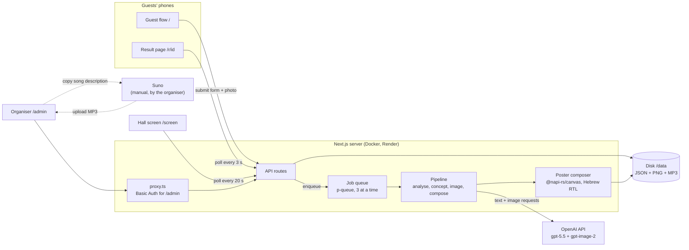
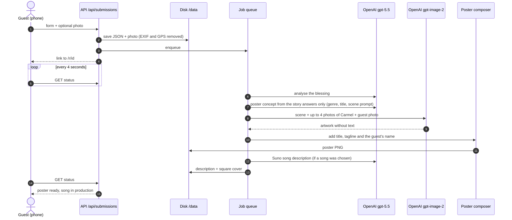
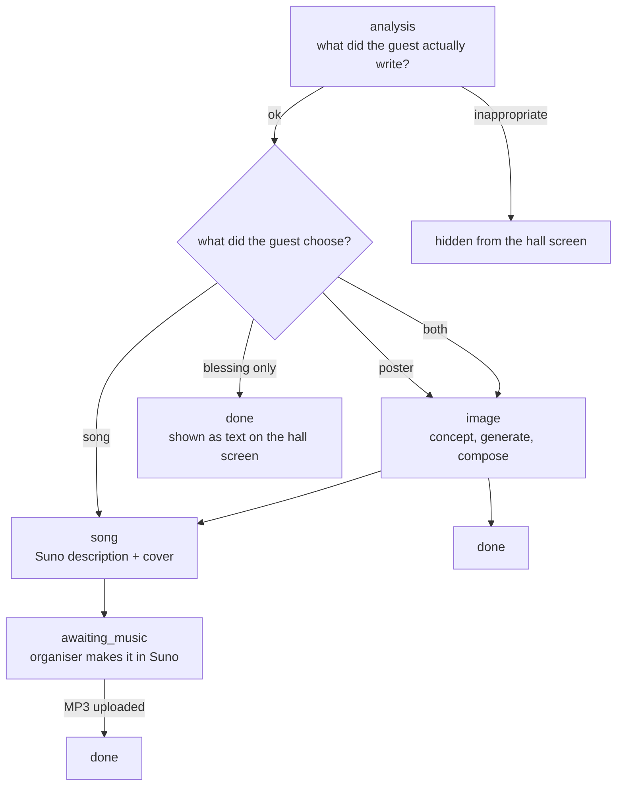
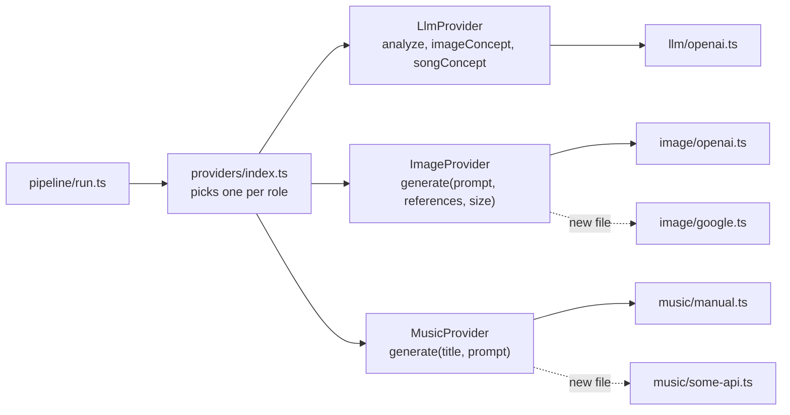
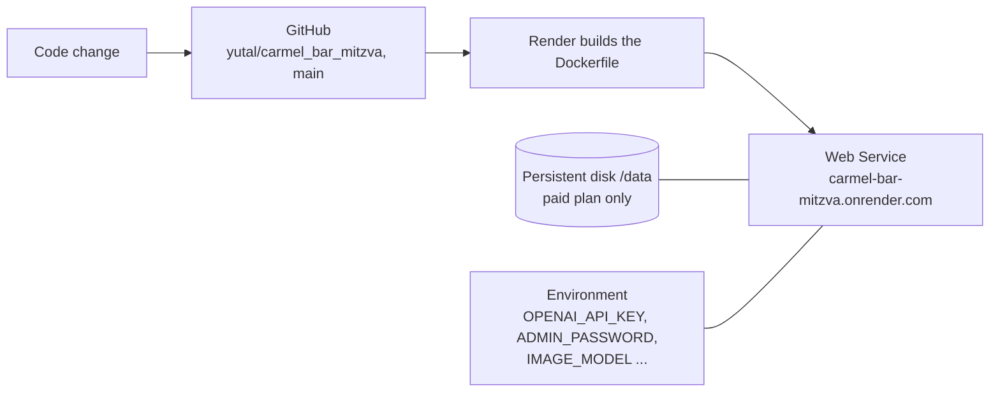
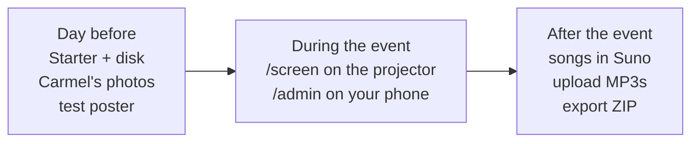

# AI Blessing Station · Carmel's Bar Mitzvah

Guests scan a QR code, tell a little about their bond with Carmel, write a blessing, pick an art style, and get a personal image of themselves with Carmel (optionally with a personal song).
The Hebrew title and blessing are drawn onto the image by our own code, not by the image model, so the Hebrew is always correct.
Every file is stored on disk with a name like `david_cohen_20261027_201530` (Hebrew names are kept as written), and after the event everything downloads as one ZIP.

**Stack**

| Layer | What we use |
| --- | --- |
| App | Next.js 16 (App Router, Turbopack, standalone output), React 19, TypeScript 5 |
| Styling | Tailwind CSS 4, Heebo and Frank Ruhl Libre fonts (on the pages and on the posters), Hebrew RTL and English LTR |
| Validation | zod 4, also for the models' structured output |
| AI | OpenAI: `gpt-5.5` (Responses API) for understanding and concepts, `gpt-image-2` for the art, `whisper-1` for transcription |
| Posters | `@napi-rs/canvas` draws the title, blessing and layout around the faces; `sharp` and `heic-convert` handle photos |
| Video | ffmpeg with libass captions, in the video and voice lab |
| Queue | `p-queue` in the server process; no database, JSON files on disk |
| Other | `archiver` for the ZIP export, `qrcode` for the hall screen |
| Hosting | Docker on Render (Web Service, Standard instance, persistent disk at `/data`), code on GitHub |
| Music | Suno, by hand: the app writes the description, the organiser uploads the MP3 |

## Contents

1. [Screens](#screens)
2. [Architecture](#architecture)
3. [What happens when a guest submits](#what-happens-when-a-guest-submits)
4. [Project structure](#project-structure)
5. [Data on disk](#data-on-disk)
6. [Models and services](#models-and-services)
7. [Guide: changing models](#guide-changing-models)
8. [Songs and Suno](#songs-and-suno)
9. [Video and voice lab](#video-and-voice-lab)
10. [Languages](#languages)
11. [Design](#design)
12. [Running locally](#running-locally)
13. [Deployment](#deployment)
14. [Event day](#event-day)
15. [Load and limits](#load-and-limits)
16. [Troubleshooting](#troubleshooting)
17. [Privacy and security](#privacy-and-security)

---

## Screens

| Path | For | What it does |
| --- | --- | --- |
| `/` | Guests, on their phones | Step-by-step form: who you are, tell us about you, blessing, what to receive, photo. A "blessing only" link on the welcome screen skips the creation and the photo |
| `/r/<id>` | The guest | Personal result page: creation number, place in line and estimated wait, then the poster to download and share, the song when ready, the blessing. "Done" appears once the creation is ready and shows a thank-you screen with a close button |
| `/screen` | Projector or TV in the hall | Slideshow of posters with their blessings, and blessing-only slides, with a large QR code |
| `/admin` | The organiser | Carmel's photos, event details, all submissions with the guest's photo, regenerate, hide, Suno, ZIP export, PDF album |

Log in to `/admin` with the user `admin` and the password set in `ADMIN_PASSWORD`.

The guest-facing UI is mobile-first, in Hebrew (right-to-left) by default or English with `?lang=en`; see [Languages](#languages).

---

## Architecture

One Next.js application in one Docker container. There is no database: each submission is a JSON file on disk, with its generated files next to it.
The heavy work (model calls, poster composition) runs in a background queue inside the same process, so the guest gets a link to their result page immediately and the page updates itself.



Key decisions:

| Decision | Why |
| --- | --- |
| Files instead of a database | One event, about 130 guests. Files are easy to back up, inspect and export |
| In-process queue | No Redis or extra service. After a restart, unfinished submissions resume automatically (`instrumentation.ts`) |
| Hebrew text drawn in code | Image models still misspell Hebrew. The model paints only the scene; the code adds title, tagline and blessing |
| Providers behind interfaces | Text, image or music models can be swapped without touching the rest of the code |
| Mock mode, `AI_PROVIDER=mock` | Run the whole flow with no API keys and no cost |

---

## What happens when a guest submits



The stages of one submission:



Each stage is `pending`, `running`, `done`, `failed` or `awaiting_music`. A failed stage can be rerun from `/admin`.

The image is built only from the guest's story ("tell us about you": what they do together, a shared memory, Carmel's talent). The blessing is not sent to the image concept and is not printed on the poster; it appears next to the poster on the result page, the hall screen and in the PDF album. Blessing-only submissions skip the photo, the quota and the queue.

While a poster waits, the result page shows the guest's place in line and an estimated time (`queuePosition` in `src/lib/pipeline/queue.ts`: guests ahead divided by the concurrency, times the median of recent run times). Once it runs, it shows the step under way: reading the story, painting, finishing. A wait that is explained and has a visible end feels shorter, so guests stay or come back to their link.

---

## Project structure

```text
carmel_bar_mitzva/
├── Dockerfile                 three-stage build, runs as the non-root node user
├── docker-entrypoint.sh       takes ownership of /data, then drops root
├── docker-compose.yml         local run, optional Cloudflare tunnel
├── railway.json               Railway deploy config
├── .env.example               every setting, with defaults
├── assets/fonts/              Frank Ruhl Libre + Heebo, used by the poster composer
└── src/
    ├── proxy.ts               Basic Auth for /admin and /api/admin
    ├── instrumentation.ts     on start-up, resumes unfinished submissions
    ├── app/
    │   ├── page.tsx           guest flow
    │   ├── r/[publicId]/      result page
    │   ├── screen/            hall screen
    │   ├── admin/             organiser dashboard
    │   └── api/               all HTTP endpoints (see below)
    ├── components/
    │   ├── GuestFlow.tsx      the six-step form
    │   ├── ResultView.tsx     poster, song, blessing
    │   ├── HallScreen.tsx     slideshow + QR
    │   ├── AdminDashboard.tsx organiser tools
    │   └── resize-image.ts    shrinks photos in the browser before upload
    └── lib/
        ├── config.ts          reads and validates environment variables
        ├── types.ts           data model + zod schemas for model output
        ├── prompts/           every prompt sent to the models
        ├── providers/         OpenAI text, OpenAI image, manual music, mock
        ├── pipeline/          run.ts (stages) + queue.ts (concurrency, resume)
        ├── compose/poster.ts  draws Hebrew text onto the artwork
        ├── storage/           files, naming, event settings
        ├── images.ts          photo clean-up, iPhone HEIC support
        └── views.ts           what a guest is allowed to see
```

API endpoints:

| Path | Method | What it does |
| --- | --- | --- |
| `/api/submissions` | POST | New submission, including the photo |
| `/api/s/<id>` | GET | Submission status, for the result page |
| `/api/s/<id>/file/<kind>` | GET | Poster, cover or MP3. Add `?download` to download |
| `/api/screen` | GET | Posters and blessings allowed on the hall screen |
| `/api/celebrant` | GET | Celebrant name, event details, whether songs are on |
| `/api/quota?name=` | GET | How many creations a guest name has left |
| `/api/health` | GET | Disk, memory and queue status, for checking a deploy |
| `/api/admin/submissions` | GET | All submissions, for the dashboard |
| `/api/admin/submissions/<id>/regenerate` | POST | Rerun a stage |
| `/api/admin/submissions/<id>/song` | POST | Upload an MP3 |
| `/api/admin/submissions/<id>/visibility` | POST | `{ "hidden": true }` hides or shows on the hall screen; `{ "test": true }` marks or unmarks a test |
| `/api/admin/submissions/mark-tests` | POST | `{ "test": true }` marks every existing creation as a test, before the event starts |
| `/api/admin/celebrant` | GET, POST, DELETE | Photos of Carmel |
| `/api/admin/event` | GET, PUT | Event details and the description of how Carmel looks |
| `/api/admin/status` | GET, PUT | Event snapshot: creations, failures, queue, OpenAI spend and balance. PUT `{ "amountUsd": 50 }` records the current OpenAI balance |
| `/api/admin/qa` | GET, POST | Style check: the latest run, or start one (paid) with styles, languages and test photos |
| `/api/admin/lab/choir` | GET, POST | The mazal tov choir: status, or build it from the lab's recordings |
| `/api/admin/export/pdf` | GET | Album to print: a cover, then one A4 page per guest with the poster and the full blessing, oldest first. Hidden-as-inappropriate submissions are left out |
| `/api/admin/export` | GET | ZIP of everything. Add `?uploads=1` to include guest photos, or `?marketing=1` for only the images of guests who allowed marketing use |

---

## Data on disk

Everything lives under `DATA_DIR`, which is `/data` on the server:

```text
/data
├── event.json                         event details + how Carmel looks
├── usage.jsonl                        every OpenAI call: tokens and estimated cost
├── openai-balance.json                the balance last entered in /admin, and when
├── celebrant/carmel_<time>.jpg        reference photos of Carmel
├── uploads/<name>_<time>.jpg          guest photos (only with consent)
├── blessings/<name>_<time>.json       the full record of one submission
├── blessings/<name>_<time>.txt        the same, human-readable, in Hebrew
├── images/<name>_<time>_raw.png       artwork from the model, no text
├── images/<name>_<time>.png           finished poster
├── songs/<name>_<time>_suno.txt       song description for Suno
├── songs/<name>_<time>_cover.png      square cover
├── songs/<name>_<time>.mp3            the song, once uploaded
├── lab/music.m4a                      background music for lab clips
└── lab/<date>_<id>/                   one lab run: input, audio.mp3, job.json, clip.mp4
```

Render's dashboard does not show this folder. View the data through `/admin`, and download everything with the "export album (ZIP)" button.

---

## Models and services

| Role | Default | Code | Environment variable |
| --- | --- | --- | --- |
| Understand the blessing, poster concept, song description | `gpt-5.5` (OpenAI Responses API, structured output) | `src/lib/providers/llm/openai.ts` | `LLM_MODEL` |
| Paint the poster scene and the cover | `gpt-image-2` (OpenAI Images API) | `src/lib/providers/image/openai.ts` | `IMAGE_MODEL` |
| Image quality | `medium` | same file | `IMAGE_QUALITY` (`low`, `medium`, `high`) |
| Generations in parallel | `3` | `src/lib/pipeline/queue.ts` | `GENERATION_CONCURRENCY` (1 to 10) |
| Keep guests' original photos | 7 days, then deleted (posters stay) | `src/lib/storage/retention.ts` | `GUEST_PHOTO_RETENTION_DAYS` (`0` = forever) |
| A guest's personal link works | 7 hours after the creation; hall-screen images keep working | `src/lib/storage/submissions.ts` | `RESULT_LINK_HOURS` (`0` = forever) |
| Music | Manual, through Suno | `src/lib/providers/music/manual.ts` | none |
| Transcribe spoken blessings (lab) | `whisper-1` with segment timestamps, Hebrew | `src/lib/providers/transcribe/openai.ts` | `TRANSCRIBE_MODEL` |
| Longest edited clip (lab) | 30 seconds | `src/lib/lab/jobs.ts` | `CLIP_MAX_SECONDS` |
| Hosting | Render, Docker Web Service | `Dockerfile` | `DATA_DIR`, `PORT` |
| Spend estimate | List prices per model, applied to the tokens each call reports | `src/lib/usage.ts` | `OPENAI_PRICES` (JSON, overrides the prices) |
| Actual spend from OpenAI | Off | `src/lib/usage.ts` | `OPENAI_ADMIN_KEY` (an organisation admin key, not the API key) |

All prompts live in one file, `src/lib/prompts/index.ts`. To change the style of posters or songs, start there.

Likeness to Carmel is kept in three layers on every poster:

1. Up to 5 photos of Carmel, plus the guest's photo if they uploaded one. Each image is labelled for the model ("Reference image 1: the celebrant").
2. A fixed identity instruction: keep face shape, eyes, hair, skin tone and age, and keep faces visible and unobstructed.
3. The "how Carmel looks" description.

**Shipped defaults:** photos in `assets/celebrant/` are copied into the data folder on every startup (as `seed_<name>`), and `assets/celebrant/look.txt` is used while the admin description is empty. This keeps Carmel's references across redeploys even without a persistent disk. A seeded photo deleted in `/admin` comes back on the next restart; remove it from `assets/celebrant/` instead.

**Group photos:** the guest photo is also shown to the text model, which lists every person in it, left to right. The image prompt and the reference label name each of them, so a selfie of four people yields four recognisable faces.

---

## Guide: changing models

### A different model from the same provider (OpenAI)

No code change needed. In Render:

1. Open the service and go to **Environment**.
2. Add or edit a variable, for example `IMAGE_MODEL` = `gpt-image-2.5-sunburst`.
3. Click **Save, rebuild and deploy**. The server comes back with the new model in a few minutes.
4. To go back, delete the variable or restore the previous value.

| Goal | Variable | Example values |
| --- | --- | --- |
| Different image model | `IMAGE_MODEL` | `gpt-image-2`, `gpt-image-2.5-sunburst`, `gpt-image-2.5-flare` |
| Higher-quality posters (slower, more expensive) | `IMAGE_QUALITY` | `high` |
| Different text model | `LLM_MODEL` | any OpenAI model that supports Structured Outputs |
| More posters in parallel | `GENERATION_CONCURRENCY` | `5`. Stay within your OpenAI account's rate limit |

> **Careful on the free plan:** every save in Environment restarts the server and erases all data. On a paid plan with a disk the data survives. Do not change settings during the event.

### A different provider (Google, Higgsfield, Flux, ...)

Each provider is a small file that implements one interface from `src/lib/providers/types.ts`:



1. Create a file, for example `src/lib/providers/image/google.ts`, exporting an object with a `generate` function. It receives the prompt, reference images and size, and returns a PNG or JPEG `Buffer`.
2. Add its API key to `src/lib/config.ts` and `.env.example`.
3. Select it in `src/lib/providers/index.ts`, for example from an environment variable.
4. Test locally with `npm run dev`, then push to `main`. Render rebuilds on its own.

An automatic music provider returns `{ kind: "audio", mp3 }` instead of `{ kind: "manual" }`; the song is then saved and shown to the guest with no manual step.

---

## Image styles

The guest picks one of six styles. Each style has an art brief (`src/lib/prompts/styles.ts`) that tells the model the look and which areas of the frame to keep calm, and a layout in `src/lib/compose/poster.ts` that draws the Hebrew text into those areas.

| Key | Style | Layout drawn by our code |
| --- | --- | --- |
| `movie` | 🎬 Movie poster | Title on top, "with love, guest · relationship" at the bottom |
| `animation` | ✨ 3D animated film | Same as movie |
| `comic` | 💥 Superhero comic | Yellow title with an ink outline, sign-off at the bottom |
| `magazine` | 📰 Magazine cover | Issue line, large red masthead with Carmel's name, cover lines, headline and tagline above the sign-off |
| `card` | ⚽ Player card | Gold frame, "13" badge, name plate, 4 stats (80–99) and the sign-off |
| `toy` | 📦 Action figure in a box | Same as movie, on the box's header card and backing |

### Who is in the picture

The image model sees up to five photos of Carmel and, maybe, one guest photo. Left alone it read each photo of Carmel as another person (Carmel twice on a cover), invented a guest when there was no photo, drew Carmel twice when he was in the guest's selfie, and filled stadiums and film scenes with extra characters. The full prompt is built in one place, `src/lib/prompts/image.ts`, and closes each of those doors for every style:

- All the photos of Carmel are named as one boy, drawn exactly once.
- The image concept lists the people in the guest photo without Carmel, and says whether Carmel is in it (`celebrantInGuestPhoto`). It gets a photo of Carmel next to the guest photo and compares faces, so a cousin of his age is not mistaken for him; when unsure, the person is listed as a guest. A guest photo that shows only Carmel is not sent to the image model at all, since it adds nobody and is the likeliest way to get him twice.
- The cast is fixed and counted: Carmel plus each person from the guest photo. With no guest photo, Carmel is alone, with no guest from behind. The head count opens the prompt and is repeated at the end, with "nobody else": no crowd, teammates, background figures or second copy of anyone. People the story mentions ("everyone screamed", the team) stay out of the picture.
- In the animated film everyone, guests included, is redrawn as a 3D character; nobody keeps a photographic face. The player card is drawn on an abstract glowing background, not a stadium.
- After painting, the face finder counts the faces. If someone was added or repeated, the image is painted again with what went wrong, up to twice; if someone was left out, once. The closest result is kept, and the extra image calls happen only when needed.

### Testing the styles

- `npm test` runs offline checks of the prompts for every style × photo case (no photo, one person, a group, a selfie with Carmel, Carmel alone) × Hebrew and English, the image-concept input (the blessing never reaches it) and the head-count check. No model calls, no cost.
- `/admin/qa` ("🧪 style check" in `/admin`) makes real posters for the chosen styles and languages, with no photo and with the photos you upload (one person, a group), exactly as a guest's poster is made. A second model then looks at each artwork with Carmel's photo and the guest photo and counts the people, Carmel's copies, extra characters, guests left out, photographic faces in drawn styles, the style and any painted text. A lifelike face on the action figure in a box counts as right. Each case shows pass or fail with the reason. It costs about one poster per case and runs only when you press the button; the page shows the estimate first.
- In mock mode the painter follows the prompt's head count, and `MOCK_EXTRA_PEOPLE=1` makes its first try add a person, to exercise the repaint.

Each style also has a rendering line (`STYLE_RENDER` in `styles.ts`), sent to the image model first and repeated last, so an animated film looks like a 3D animated still and not a photograph, and a magazine cover is a studio shoot on a plain backdrop and not an outdoor movie scene.

### Text on the picture

Only the title (and tagline), the sign-off "with love, guest · relationship", the footer and the event date are drawn on the picture; the blessing is never printed on it. It is shown beside the poster on the hall screen, on the result page and in the album. The face finder's boxes, with a margin for hair and chin, keep every line off the faces:

- Movie, animation, comic and toy box: the title goes on top if it fits above the faces (with the tagline, then without), otherwise in the free band between the faces and the sign-off. Only when neither has room is it drawn small at the very top on a soft dark caption band, so it reads as a deliberate strip. The sign-off shrinks until it clears the faces, and gets the same band when it cannot.
- Magazine: cover lines go only in a side column with no face; the headline moves into the cover lines when there is no room under the faces.
- Player card: the name plate moves down below a low face; when the stats would then cover someone, they are left out.

To add a style: add it to `IMAGE_STYLES` in `src/lib/types.ts` and to `STYLE_BRIEFS`; if it needs its own text layout, add a function to `compose/poster.ts`.

---

## Languages

Guests pick **עברית** or **English** on the welcome screen (`/?lang=en`). The choice sets the page direction, every string on the guest and result pages (`src/lib/i18n.ts`), and the language of everything printed on the creation: title, tagline, cover lines, stats, song title. Blessings can be written in any language; the prompts read them as they are, and the poster draws each line right to left or left to right by its first letter. English creations use "celebrant name in English" and "footer in English" from `/admin`. The video lab has its own spoken-language switch.

To add a language: add it to `LANGS` in `src/lib/types.ts`, then to `LANG_INFO` and `STRINGS` in `src/lib/i18n.ts`.

## Songs and Suno

Songs are **off by default**. Turn them on in `/admin` with "allow guests to choose a song". When off, the guest only sees the image styles, and the server ignores any song request.

The system does not write lyrics. It prepares a short **song description** in English, with names kept in Hebrew, based on the guest's answers on the "tell us about you" step: what they do together, a shared memory, and what Carmel is best at. Suno writes the lyrics and the music.

Suno has no official API, so the last step is manual:

1. In `/admin`, filter by "waiting for song".
2. Click "copy description for Suno" and open Suno.
3. Paste into the Song Description box, generate, and download the version you like as MP3.
4. Back in `/admin`, click "upload MP3" on that submission. The song appears on the guest's page immediately.

This can be done in the days after the event.

---

## Video and voice lab

`/admin/lab` (admin only) runs the pipeline a guest's video or voice blessing would go through, so it can be tried before it is offered to guests.

1. Upload a video or audio file (up to 5 minutes, 200MB), or record up to a minute in the browser.
2. ffmpeg extracts the voice; `whisper-1` transcribes it in Hebrew with timestamps per sentence and per word. A recording made in the browser (Chrome writes webm without a length) gets its length from the last audio packet.
3. `gpt-5.5` picks 1 to 3 runs of whole sentences, in their original order, up to 30 seconds, and the strongest line as a quote (`CLIP_PLAN_SYSTEM` in `src/lib/prompts/index.ts`).
4. ffmpeg edits a vertical 720×1280 clip (`src/lib/media/clip.ts`):
   - a 3-second opening with a slow push-in on the guest's poster, or a title card when there is none;
   - the chosen parts with captions in the style of short-form video: two or three words at a time, popping in as they are said, the word being said in gold and the celebrant's name always in gold (libass + fribidi; landscape video sits over a blurred copy of itself; voice-only shows the poster and a live waveform);
   - a closing card with the quote, the guest's name and the event;
   - loudness evened out, and optional background music that ducks under speech.

Background music is uploaded once on the lab page and used for every clip. Use only music you have the right to use.

Each result shows the clip, the transcript with the kept sentences highlighted, time per step and the transcription cost (about $0.006 a minute). Editing takes about 10 seconds on 4 CPUs; expect roughly 30 to 40 seconds on a 1-CPU instance. Clips run one at a time.

### Mazal tov choir

The "🎤 mazal tov choir" card on the lab page builds one montage from every finished recording (`src/lib/media/choir.ts`, `/api/admin/lab/choir`):

1. In each transcript it finds the words "מזל טוב" (or "mazal tov"), with the celebrant's name when it follows.
2. It cuts exactly those words from each recording into a vertical segment with the guest's name on top. Segments play one after another, cut tighter as it goes so the pace picks up.
3. The finale plays every voice at once, each a few hundredths of a second after the last, over a mosaic of all the faces, with a large "מזל טוב כרמל!".
4. A title card opens it and a closing card ends it; the lab's background music, if any, ducks under the voices.

It makes no OpenAI calls: it reuses the word times saved with each recording. Recordings transcribed before word times were added, or with no "mazal tov" in them, are listed as left out. Building takes about 10 seconds for 4 recordings on 4 CPUs.

The Docker image installs Debian's `ffmpeg`. `/api/health` reports `videoLab.ffmpeg`.

---

## Design

Direction A: modern, light olive green, with a large 13 above "הבר מצווה של כרמל". The source is in Figma; the tokens are defined in `src/app/globals.css`.

| Token | Colour | Use |
| --- | --- | --- |
| `canvas` | `#f6f6ee` | Page background |
| `surface` | `#ffffff` | Cards and fields |
| `olive-100` | `#eceedc` | Secondary backgrounds |
| `line` | `#dce0bf` | Borders and dividers |
| `accent-soft` | `#9aa46a` | The big 13, soft highlights |
| `accent` | `#5e6a3a` | Buttons, headings |
| `ink` | `#2d331c` | Text |
| `muted` | `#6b7350` | Secondary text |
| `clay` | `#d9875e` | "של כרמל", warm accents |
| `sand` | `#f1e4cb` | Notes |

| Font | Role |
| --- | --- |
| Frank Ruhl Libre (500, 700, 900) | Headings, the 13, poster title |
| Heebo | All other text |

Principles: mobile-first, Hebrew right-to-left on every screen, large tap targets, one step per screen.

---

## Running locally

```bash
cp .env.example .env.local   # OPENAI_API_KEY and ADMIN_PASSWORD, or AI_PROVIDER=mock
npm install
npm run dev                  # http://localhost:3000
```

With `AI_PROVIDER=mock` the whole flow works with no keys, using placeholder text and images. Use it to test changes at no cost.

Before every push:

```bash
npx tsc --noEmit && npm run lint && npm test && npm run build
```

Docker on your own machine, with an optional temporary public address:

```bash
cp .env.example .env
docker compose up --build                     # http://localhost:3000
docker compose --profile tunnel up --build    # + public https address (see the tunnel logs)
```

---

## Deployment



### Render (current)

1. **New → Web Service → Public Git Repository**, URL `https://github.com/yutal/carmel_bar_mitzva`.
2. **Language:** Docker.
3. **Environment:** `OPENAI_API_KEY`, `ADMIN_PASSWORD`, and optionally `IMAGE_MODEL` and the other variables.
4. **Before the event:** switch to **Starter** and add a **Disk** mounted at `/data`, 1 GB.
5. Every push to `main` builds a new version. If it doesn't, use **Manual Deploy → Deploy latest commit**.

| | Free | Starter |
| --- | --- | --- |
| Price | 0 | about $7/month, plus the disk |
| Data | Erased on every deploy or when the server sleeps | Kept on the disk |
| Sleep | After 15 minutes idle; the next visit takes about a minute | Always on |
| Use for | Testing | The event |

After a deploy, open `/api/health` (public, no secrets). It shows whether `/data` is a mounted persistent disk and writable, free disk space, the instance's memory limit and CPUs, the V8 heap limit, and the queue. On a paid instance with a disk, `storage.persistentDisk` must be `true`.

**Resources:** the V8 heap is set at startup to 60% of the instance's memory limit (`docker-entrypoint.sh`), and photo decoding uses all CPUs, so a larger instance is used automatically. A service with a disk runs on a single instance, so scale up (a larger instance), not out. Raise `GENERATION_CONCURRENCY` only as far as the OpenAI tier allows (see Load and limits).

### Railway (alternative)

1. **New Project → Deploy from GitHub repo**, pick the repo. It builds from the Dockerfile.
2. Add a **Volume** mounted at `/data`.
3. In **Variables** set `OPENAI_API_KEY` and `ADMIN_PASSWORD`.
4. **Settings → Networking → Generate Domain.**

---

## Event day



- **Day before:** switch to the paid plan with a disk, upload 3 clear photos of Carmel, fill in "how Carmel looks", make a test poster, and print the QR code for the tables.
- **Just before guests arrive:** press `🧪 mark all existing as test` in `/admin`. Test creations stay in `/admin` under the `🧪 tests` filter, but are left out of the hall screen, the PDF album, the marketing ZIP, the event status counts and the guest's creation limit. A single creation can also be marked or unmarked with its `🧪 test` button.
- **During the event:** `/screen` full-screen on the projector, `/admin` on your phone. Do not change settings in Render. The "event status" panel at the top of `/admin` shows posters done, the queue, failures, the OpenAI spend and how many more posters the balance covers. Enter the balance from platform.openai.com (Billing) before the event and after every top-up; the panel turns red when it will not last for the queue plus another 20 guests.
- **Hall screen:** checks for new creations every 15 seconds (one small request; 15 s keeps it current without load). A new creation jumps the line with a "new!" badge so the guest sees it within a minute. Each slide stays 10 to 20 seconds, longer for a longer blessing, and the blessing sits beside the poster.
- **After the event:** produce the songs in Suno, upload the MP3s, download the ZIP and the PDF album (`📖 album to print` in `/admin`). Once you have checked it, you can cancel the plan.

---

## Load and limits

Measured locally in mock mode on one CPU core with the V8 heap sized for 2 GB (the Render Standard instance), ~250 KB phone-sized photos on half the submissions, and every guest submitting at the same moment. `MOCK_IMAGE_DELAY_MS=20000` stands in for the real image model.

| Guests at once | `GENERATION_CONCURRENCY` | Submit response, p95 | Peak memory | All posters done |
| --- | --- | --- | --- | --- |
| 60 | 3 | 2.9 s | 456 MB | 7 min |
| 120 | 10 | 6.4 s | 635 MB | 4.7 min |

300 page loads at the same moment all succeeded, in about 3.3 s each. No request failed in any run.

- **Web server:** not the bottleneck. A Standard instance (2 GB, 1 CPU) takes 120 guests submitting at once with room to spare. Photo decoding is limited to two at a time, and the image sets `MALLOC_ARENA_MAX=2` and a V8 heap sized to the instance.
- **Generation:** runs in a queue. A real poster takes about a minute, so with 60 guests at once and `GENERATION_CONCURRENCY=3` the last one waits about 20 minutes. On a Standard instance 6 to 8 is a good setting, if OpenAI allows it. Guests can close the page and come back to their link.
- **OpenAI is the real bottleneck.** Image limits depend on the account's usage tier: Tier 1 allows 5 images per minute, Tier 2 allows 20, Tier 3 allows 50. Keep `GENERATION_CONCURRENCY` at 3 on Tier 1. Check the tier at platform.openai.com under Limits.
- **Scaling:** a service with a persistent disk runs as one instance on Render, and the queue and files live on that instance, so autoscaling does not apply. For a bigger event, switch to a larger instance for the day; Render charges by the second.
- **Memory:** if the logs show out-of-memory errors, lower `GENERATION_CONCURRENCY` or use a larger instance.

To repeat the test: `AI_PROVIDER=mock MOCK_IMAGE_DELAY_MS=20000 taskset -c 0 node --max-old-space-size=1228 .next/standalone/server.js`, then send concurrent page loads and multipart submissions to `/api/submissions` and poll each result until it is done.

### OpenAI spend and balance

OpenAI has no API for the remaining prepaid balance, so the app keeps its own count. Every call logs its tokens to `usage.jsonl` with a cost at list prices. You enter the balance shown on the billing page in `/admin`; the panel subtracts what was spent since then and divides by the average cost of a finished poster. The figures are estimates: the billing page stays the source of truth.

For the actual billed amount, set `OPENAI_ADMIN_KEY` (Organization settings → Admin keys). The panel then also shows today's and the last 30 days' spend from OpenAI's Costs API, which updates with a delay. If OpenAI changes its prices, set `OPENAI_PRICES`, for example `{"gpt-image-2":{"input":2.5,"imageInput":4,"output":15}}` (USD per million tokens).

---

## Troubleshooting

| Symptom | Cause | Fix |
| --- | --- | --- |
| "היצירה לא נמצאה" (creation not found) | The server restarted on the free plan and the data was erased | Submit again. For the event: paid plan with a disk |
| Carmel's photos or description disappear from `/admin` | Same cause | Upload again. For the event: a disk |
| `/admin` returns an error | `ADMIN_PASSWORD` is not set | Set it in Environment |
| "משהו לא הסתדר עם הפוסטר" (poster failed) | An OpenAI error: rate limit, organisation verification, wrong model name | Read the error on the card in `/admin` or in Logs, then "poster, same idea" |
| The poster doesn't look enough like Carmel | Weak reference photos | Clear, front-facing face photos in good light, and fill in "how Carmel looks" |
| The first visit is very slow | The free server was asleep | Wait a minute. Doesn't happen on a paid plan |

Logs are in the Render dashboard, on the service's **Logs** tab. **Events** shows deploys, and **Metrics** shows memory and CPU.

---

## Privacy and security

- A guest photo is sent to OpenAI only if the guest uploaded it after the consent notice. Metadata, including GPS location, is removed before saving.
- Each guest, matched by name, can make up to `MAX_CREATIONS_PER_GUEST` creations (default 3, 0 = no limit). The form checks this right after the name, and the server enforces it on submit.
- Marketing use is a separate opt-in checkbox, unchecked by default. `/admin` filters these submissions and exports them as their own ZIP.
- A poster appears on the hall screen only with the guest's consent, and any poster can be hidden or marked as a test from `/admin`. Inappropriate content is hidden automatically.
- Guests' original photos are deleted automatically after `GUEST_PHOTO_RETENTION_DAYS` (default 7). The check runs at start-up and every hour; the posters made from them are kept.
- Each guest gets a link with a random 16-character id (96 bits), so links cannot be guessed or listed; the site is marked noindex. The link stops working `RESULT_LINK_HOURS` after the creation (default 7, enough for the evening). Images of creations shown on the hall screen keep loading after that, so the slideshow is not affected; MP3s uploaded later are not reachable through an expired link. The organiser keeps everything in `/admin` and the ZIP.
- The export leaves out guest photos unless `?uploads=1` is added.
- `/admin` and all of `/api/admin` are password-protected with a timing-safe comparison. With no password set, admin is closed entirely.
- Keys live only in the server's environment variables, never in the code. `.env` and `/data` are never committed.
- The server runs as a non-root user.
- Carmel's photos are not stored in the repository; they are uploaded through `/admin` only.
