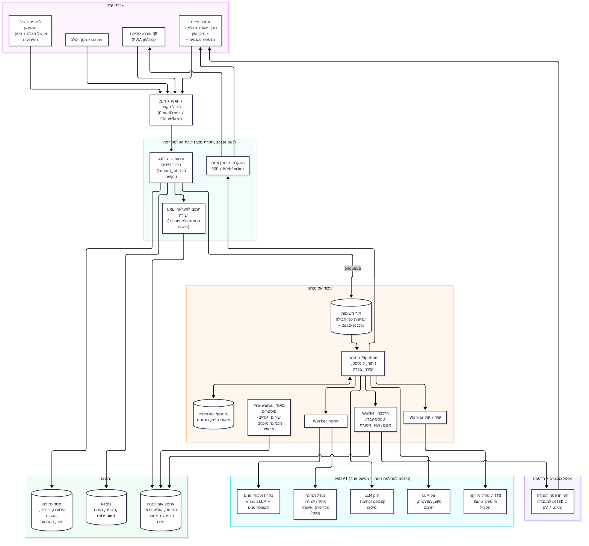
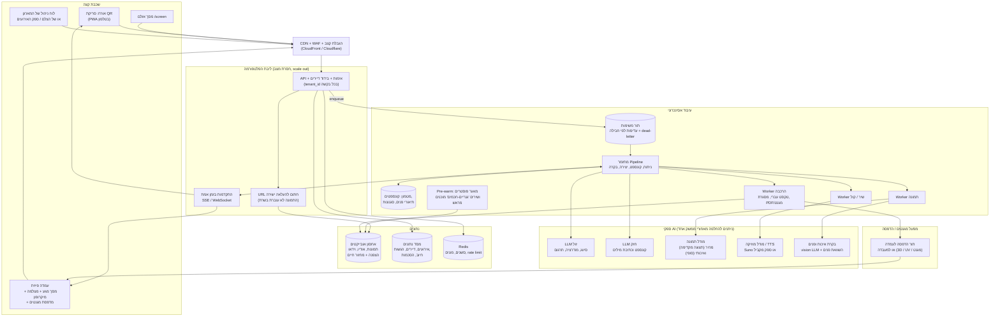
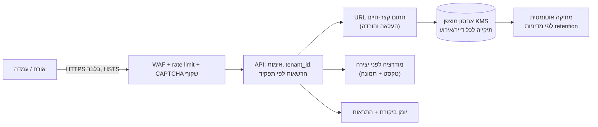
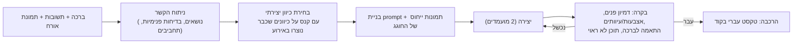

# ארכיטקטורה מקצה לקצה: פלטפורמת "זיכרונות אירוע" רב-דיירית

מסמך זה מתאר את הארכיטקטורה המומלצת להפיכת מערכת הברכות של כרמל לעסק: פלטפורמה אחת שמשרתת הרבה אירועים במקביל, ונמכרת גם כחבילה לצלמי מגנטים וספקי אירועים וגם כעמדות עצמאיות (מצלמה, מיקרופון, מסך מגע ומדפסת מגנטים).

המספרים בעלויות הם הערכות מסדר גודל לצורכי תכנון. לפני החלטה עסקית יש לאמת אותם מול דפי המחירים העדכניים של כל ספק.

## 1. תמונת על

הגרסה הניתנת לעריכה (Mermaid):

### רכיבים ותפקידים

| שכבה | תפקיד | הערה |
| --- | --- | --- |
| PWA לאורח | טופס, צילום, תצוגה מקדימה, הורדה ושיתוף | ללא התקנה, עברית RTL |
| עמדה פיזית | אותה אפליקציה במצב "קיוסק" + חיבור למדפסת מגנטים | עובדת גם בהתנתקות קצרה (תור מקומי) |
| API חסר מצב | אימות, הרשאות, מכסות, יצירת משימות | ניתן להרצה כמופעים רבים |
| תור + Workers | כל העבודה הכבדה מחוץ לבקשת ה-HTTP | scale לפי אורך התור |
| מסד נתונים | דיירים, אירועים, הגשות, הסכמות, חיוב | Postgres מנוהל |
| אחסון אובייקטים | כל הקבצים, עם מחזור חיים ומחיקה אוטומטית | S3 או תואם |

## 2. Scale up / down

הלחץ בפלטפורמה כזו הוא ב"פיצוץ" של 20 עד 40 דקות סביב הקבלת פנים והרחבה, ובין אירועים השימוש קרוב לאפס.

- **תור משימות** מפריד בין קליטת בקשות (מהירה) לבין יצירה (איטית ויקרה). האורח מקבל קישור מיד.
- **Workers עם autoscaling לפי אורך התור** ולא לפי CPU, כי רוב הזמן ה-worker ממתין לספק AI. מצב שקט: אפס workers (scale to zero).
- **הגבלת מקביליות לפי ספק** (rate limit גלובלי לכל ספק AI, עם backoff), כדי שאירוע אחד לא יחסום אחרים.
- **עדיפויות בתור**: חבילה פרימיום, אירוע פעיל כרגע, ואז אירועים אחרים. משימות שנכשלו נכנסות ל-dead-letter עם retry מבוקר.
- **אירועים מתוזמנים**: המארגן מגדיר שעת פתיחה, והמערכת מחממת (pre-warm) קיבולת ומאגר פוסטרים 15 דקות לפני.
- **בידוד רעש שכנים**: מכסת הגשות לדקה לכל דייר (tenant).

## 3. אבטחה מקיפה

1. **בידוד דיירים:** כל שורה וכל אובייקט נושאים `tenant_id` ו-`event_id`. בדיקת הרשאה בשכבת הנתונים, לא רק ב-UI. בדיקות אוטומטיות שמוודאות שדייר לא קורא נתוני דייר אחר.
2. **זהות והרשאות:** מארגן וצלם מתחברים (OIDC / מנהל זהויות מנוהל). אורחים אנונימיים מקבלים אסימון קצר-חיים הקשור לאירוע. תפקידים: בעלים, צלם, צוות, צופה.
3. **הצפנה:** TLS בתעבורה, הצפנה במנוחה עם מפתחות מנוהלים, סודות (מפתחות ספקי AI) במנהל סודות ולא במשתני סביבה בקוד.
4. **URL חתומים:** העלאה והורדה ישירות מול האחסון בקישורים שפגים תוך דקות. אין קבצים ציבוריים. קישור שיתוף לאורח הוא אסימון אקראי עם תפוגה.
5. **הסכמה ופרטיות:** מסך הסכמה מפורש בהגשה (תמונה, שימוש בפנים, שמירה). קטינים: הסכמת הורה/מארגן ברמת האירוע. ללא שימוש בנתונים לאימון, ובדיקה שחוזי הספקים כוללים "zero retention" או "no training" לאן שאפשר.
6. **מחיקה ו-retention:** ברירת מחדל 30 עד 90 יום אחרי האירוע, ניתנת להגדרה. כפתור "מחק הכול" למארגן, ומחיקה מלאה כולל גיבויים לפי מדיניות.
7. **מודרציה:** סינון טקסט ותמונה לפני שליחה לספק וגם על התוצאה, כדי שלא ייווצר תוכן פוגעני תחת המותג של הלקוח.
8. **הגנה על העלויות:** מכסות לכל אורח ולכל אירוע, תקרת הוצאה יומית לכל ספק, התראה בחריגה. זו גם אבטחה, כי זליגת מפתח או בוטים מתורגמים ישר לכסף.
9. **שרשרת אספקה ובדיקות:** סריקת תלויות, תמונות מאומתות, העלאה רק לסוגי קבצים מותרים, הסרת EXIF ו-GPS (כבר קיים), הגבלת גודל, פענוח תמונות בתהליך מבודד.
10. **צד העמדה הפיזית:** קיוסק נעול (מצב kiosk), עדכונים מרחוק, אסימון מכשיר ייחודי שניתן לבטל, ללא גישה לדפדפן חופשי.

## 4. אופטימיזציה למחיר

| טכניקה | חיסכון משוער | איך |
| --- | --- | --- |
| מודל זול לשלבים קלים | גבוה | סיווג, מודרציה, חילוץ תבניות ותרגום במודל קטן. מודל חזק רק לקונספט ולמילים |
| תצוגה מקדימה זולה, סופי יקר | גבוה | מודל תמונה מהיר ברזולוציה נמוכה לאישור, והאיכותי רק אחרי אישור האורח |
| מטמון | בינוני | תיאור פנים של החוגג מחושב פעם אחת לאירוע. סגנונות וקונספטים נפוצים נשמרים |
| ביטול כפילויות | בינוני | אותו אורח שלוחץ פעמיים לא משלם פעמיים (מפתח אידמפוטנטי) |
| מאגר פוסטרים מראש | בינוני | רקעים וסצנות בסגנונות נפוצים נוצרים מראש בשעות זולות, ובזמן אמת רק מחליפים פנים/טקסט |
| Batch לשעות לא דחופות | בינוני | שירים לאלבום, ווידאו מסכם וכרטיסי תודה ב-batch (זול יותר אצל חלק מהספקים) |
| מגבלת "יצירה אחת בחינם, שנייה בתשלום" | גבוה | מגן על שולי הרווח בעמדות ובאירועים גדולים |
| Spot / קיבולת זולה ל-workers | בינוני | המשימות idempotent ולכן ניתן לאבד worker באמצע |
| מחזור חיים באחסון | נמוך אך קבוע | מעבר ל-Infrequent Access ומחיקה אוטומטית |

עיקרון: **מדידה לכל הגשה.** לוג עלות לכל קריאה (כבר קיים ב-`usage.jsonl`) הופך ל-`cost_per_creation` בכל אירוע, כך שהתמחור מבוסס נתונים.

## 5. דיוק וגיוון בתוצאה

- **תמונות ייחוס מרובות** של החוגג (פנים, חצי פרופיל, מצב רוח שונה) ובחירת המתאימות לסצנה.
- **בקרת איכות אוטומטית** אחרי היצירה: מודל vision שבודק דמיון פנים, עיוותים והתאמה לברכה. עד שני ניסיונות חוזרים, ואז חלופה בטוחה.
- **גיוון מכוון:** המערכת מחזיקה לכל אירוע רשימת ז'אנרים וסגנונות שכבר נוצרו, ודוחפת כיוון שונה לאורח הבא. אין שני פוסטרים זהים בחוויה.
- **טקסט עברי תמיד בקוד**, לא במודל (כפי שכבר נעשה).
- **משוב:** כפתור "לא זה" אחד שמחולל וריאציה, והנתונים מזינים שיפור של ה-prompts.
- **עריכה אנושית:** המארגן יכול להחליף או לאשר ידנית לפני הדפסה ביוקרה.

## 6. זמן מבקשה ליצירה ("וואו, זה כבר מוכן")

המטרה: האורח רואה משהו תוך שניות, והתוצר הסופי תוך כדקה.

```mermaid
gantt
    title ציר זמן מומלץ לאורח אחד
    dateFormat  s
    axisFormat  %S ש'
    section אורח
    ממלא טופס (העלאת התמונה ברקע)  :a1, 0, 20s
    section מערכת
    ניתוח הקשר + כיוון יצירתי       :b1, 8, 6s
    תצוגה מקדימה מהירה (נמוכה)      :b2, 14, 8s
    יצירה סופית באיכות מלאה        :b3, 22, 35s
    הרכבה + QR + מגנט              :b4, 57, 5s
    section חוויה
    סקיצה מופיעה ואז "מתחדדת"        :c1, 22, 35s
```

טכניקות:

1. **התחלה לפני סיום הטופס:** ברגע שיש שם וקשר, מחממים את הקשר ומתחילים בניתוח, והתמונה עולה ברקע בזמן שהאורח כותב ברכה.
2. **תצוגה מקדימה מיידית:** סקיצה/תמונה מטושטשת ראשונה תוך כמה שניות, שמתחדדת עד התוצאה הסופית.
3. **יצירה מקבילה:** תמונה, שיר ווידאו נוצרים במקביל, וכל אחד מופיע כשהוא מוכן.
4. **התקדמות אינטראקטיבית:** הודעות אמיתיות ("מצאנו את הבדיחה על הכדורסל...") ומשחק קטן או טריוויה על כרמל בזמן ההמתנה.
5. **מאגר מוכן מראש** לשעות שיא (סעיף 4) והחלפת פנים/טקסט בלבד.
6. **עמדה פיזית:** המגנט מודפס מיד כשהתוצר מאושר, והעמדה מציגה שעון ספירה לאחור.
7. **שיר:** מילים ותצוגה מקדימה קצרה (30 שניות) מיד, השיר המלא נשלח בקישור כשהוא מוכן. אין צורך שהאורח יחכה ליד העמדה.

## 7. האם לעבור ל-AWS?

**המלצה: לא עכשיו, ולא בבת אחת. כן, בהדרגה, ברגע שעוברים לאירוע הרב-דייר הראשון בתשלום.**

המערכת הנוכחית (Next.js בקונטיינר אחד על Render, דיסק קבוע, תור בתוך התהליך, בלי מסד נתונים) מתאימה בדיוק לאירוע אחד של כ-130 אורחים, וזה מה שהיא נבנתה לו. היא נשברת ברגע שמוכרים לכמה לקוחות במקביל:

| מגבלה נוכחית | למה זו בעיה לעסק |
| --- | --- |
| מופע יחיד עם דיסק | אין autoscaling ואין זמינות גבוהה. אירוע של 800 אורחים דורש "מכונה גדולה יותר" ידנית |
| תור בתוך התהליך | אתחול או קריסה מאבדים עבודה בתהליך, ואין עדיפויות בין לקוחות |
| קבצים ללא מסד נתונים | אין דיירים, חיוב, חיפוש, הרשאות לפי תפקיד, דוחות |
| אין בידוד לקוחות | חשיפה משפטית ועסקית אם צלם אחד רואה נתוני אחר |

### תוכנית מדורגת

| שלב | מתי | מה עושים | פלטפורמה |
| --- | --- | --- | --- |
| 0. היום | אירוע אחד | להישאר כמו שהמערכת | Render כפי שהיא |
| 1. פיילוט בתשלום | 1 עד 5 אירועים, מקורבים | אחסון אובייקטים (S3 או R2) במקום דיסק, Postgres מנוהל, `tenant_id`, URL חתומים | עדיין אפשר Render + S3. זה השלב שבו ההחלטה על AWS נהיית רלוונטית |
| 2. מוצר | צלמים משלמים, אירועים במקביל | תור מנוהל (SQS) + workers עם autoscaling, Redis, CDN, WAF, Cognito או אחר, ניטור | **AWS**: ECS Fargate (או Lambda למשימות קצרות), SQS, S3, CloudFront, RDS/Aurora Serverless, Secrets Manager, KMS |
| 3. סקייל | עשרות אירועים בסופ"ש, עמדות | multi-region אם צריך, תשתית כקוד (Terraform/CDK), חשבון נפרד לפרודקשן | AWS מלא + צי עמדות (IoT / עדכוני מכשירים) |

### למה AWS בשלב 2

- **S3 + CloudFront + URL חתומים** פותרים אחסון, מהירות הורדה ואבטחה במחיר נמוך. אפשר גם Cloudflare R2 (אין עלות יציאת נתונים), וזו אלטרנטיבה סבירה אם רוצים לחסוך.
- **SQS + autoscaling של Fargate/Lambda** נותנים בדיוק את ה-scale up ו-scale to zero מהסעיף 2, ללא ניהול שרתים.
- **KMS, IAM, WAF, CloudTrail** הם מה שלקוחות עסקיים וצלמים ישאלו עליו כשמעבירים להם תמונות של ילדים.
- **עלות:** התשתית עצמה זולה (בדרך כלל עשרות עד כמה מאות דולרים בחודש בשלב 2). העלות הדומיננטית היא מודלי ה-AI, לא ה-cloud, ולכן המעבר לא ישנה את שורת הרווח, אבל כן את היציבות.

### מתי לא לעבור

- אם אין עדיין לקוח משלם שני: ההוצאה ההנדסית (שבועות עבודה) לא מצדיקה.
- אם הצוות הוא אדם אחד: אפשר להישאר על PaaS (Render/Fly/Railway) + S3/R2 + Postgres מנוהל + תור כמו Upstash/BullMQ ולהגיע ל-80% מהתועלת ב-20% מהמאמץ.
- סיכון נעילה: לשמור הכול מאחורי ממשקים (`StorageProvider`, `QueueProvider`, `ImageProvider`, `MusicProvider`) כפי שכבר נעשה בקוד, כדי שהמעבר ל-AWS יהיה החלפת מימוש ולא כתיבה מחדש.

### סדר פעולות מומלץ

1. להכניס מסד נתונים ו-`tenant_id` (גם אם יש דייר אחד).
2. להחליף דיסק ב-S3/R2 עם URL חתומים.
3. להחליף את התור בתהליך בתור חיצוני, ולהפריד את ה-workers לשירות נפרד.
4. רק אז לעבור לתשתית AWS מלאה עם autoscaling.

## 8. מה שנגזר מהמסמך לתכנון המוצר

- **שלוש חבילות** (הצעה לדיון): תמונה ומגנט בלבד, תמונה + שיר + וידאו, ועמדה מלאה עם הדפסה במקום. כל שכבה משתמשת באותה פלטפורמה ומפעילה workers שונים.
- **שני מודלי מכירה** על אותה תשתית: SaaS לצלמי מגנטים (לוח ניהול ומותג לבן) ועמדה מושכרת/נמכרת (חומרה + רישיון).
- **תמחור לפי אירוע** צריך להתבסס על `cost_per_creation` הנמדד, ולכן מדידה לכל הגשה היא דרישת חובה ולא "נחמד שיהיה".

הערכות עלות מפורטות לפי גודל אירוע (150 / 300 / 500 / 800 / 1000+), מחקר מתחרים והצעות שמות מטופלים בנפרד.
