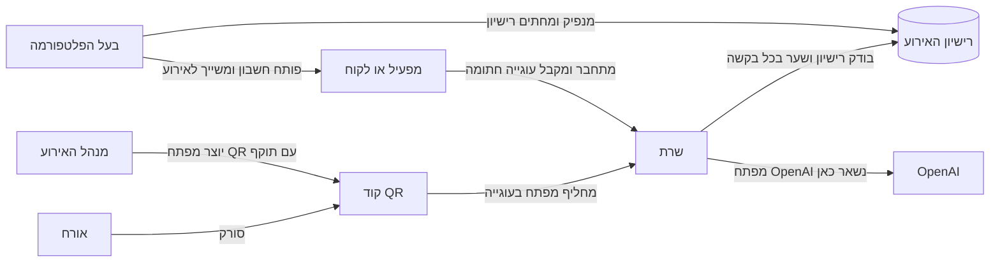
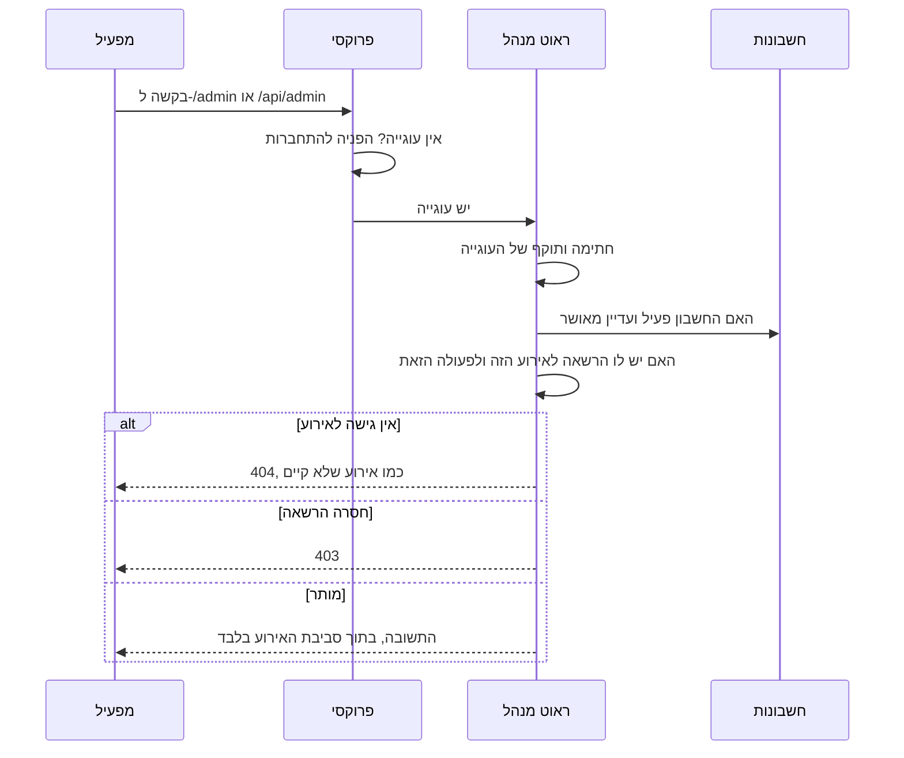
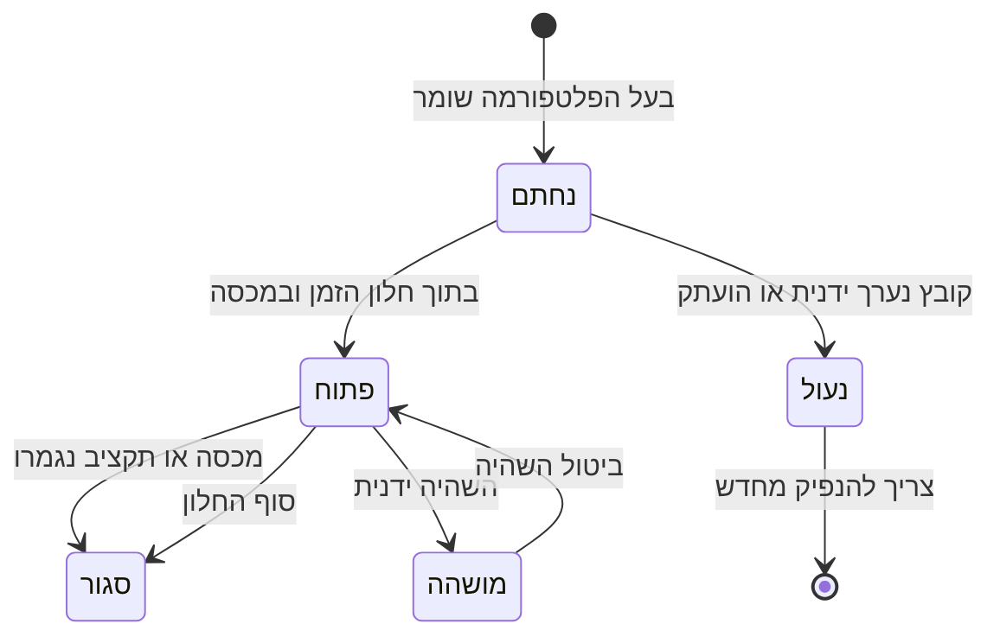
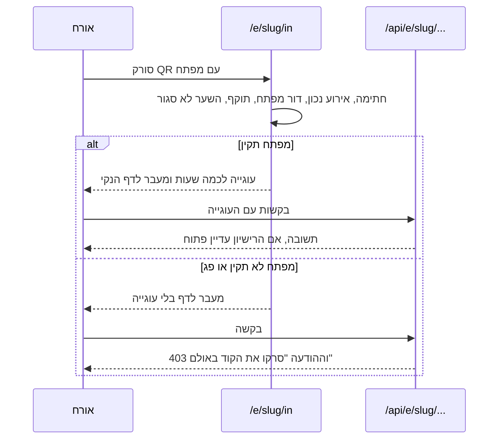
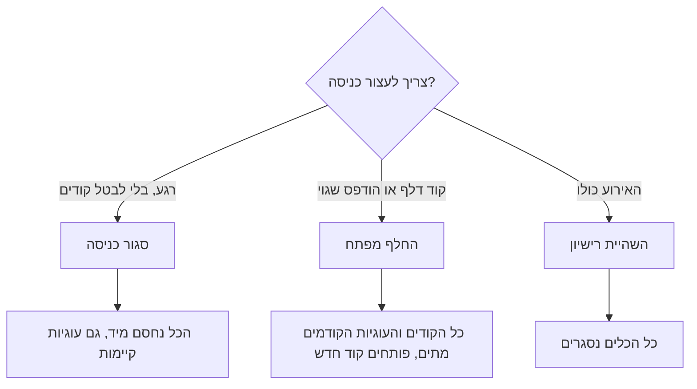
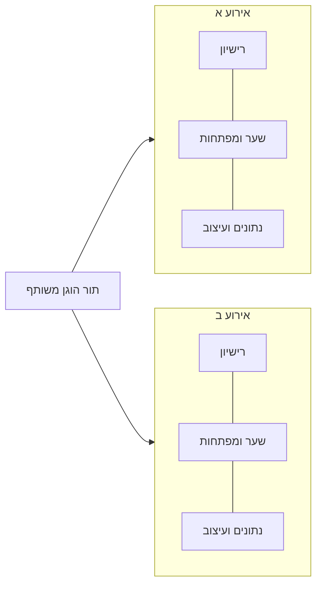

# אבטחה, רישיון וכניסה בקוד QR

## מה זה "רישיון"

הרישיון הוא לא מפתח API ולא סיסמה זמנית. זה קובץ הגדרות לכל אירוע (`license.json`) שקובע **מה מותר באירוע הזה**: אילו כלים פתוחים, באיזה חלון זמן, כמה יצירות ובאיזה תקציב AI. את הקובץ חותם השרת עם מפתח סודי שנמצא רק אצלו (HMAC). בכל בקשה השרת בודק את החתימה. מי שערך את הקובץ ביד, או העתיק אותו לאירוע אחר, מקבל אירוע נעול.

במערכת יש ארבעה דברים שונים, וכל אחד עונה על שאלה אחרת:

| מה | השאלה שהוא עונה | מי מנפיק | כמה זמן חי |
|---|---|---|---|
| רישיון | מה מותר לאירוע הזה | בעל הפלטפורמה בלבד | עד שמשנים או מגיע סוף החלון |
| חשבון ועוגיית התחברות | מי המנהל או המפעיל ומה הוא רשאי | בעל הפלטפורמה פותח חשבון, המפעיל מתחבר | `SESSION_HOURS` (12 שעות כברירת מחדל), וניתן לבטל מיד |
| מפתח כניסה ב-QR | האם הטלפון הזה היה באירוע | מנהל האירוע | דקות עד שעות, לא מעבר לסוף הרישיון |
| מפתח OpenAI | ההרשאה לשלם על ה-AI | רק בשרת, בקובץ הסביבה | לא יוצא מהשרת בשום מצב |

אין "API זמני" שמוסרים ללקוח. ללקוח או למפעיל נותנים חשבון עם תפקיד, והרישיון הוא מה שהחשבון הזה יכול להפעיל.

## התמונה הכללית

## התחברות והרשאה לפעולה

כמה כללים שנאכפים בקוד ובבדיקות אוטומטיות:

- כל ראוט מנהל עובר דרך עטיפה שבודקת הרשאה. בדיקה אוטומטית נכשלת אם ראוט עוקף אותה.
- הקוד של כל בקשה רץ בתוך תיקיית האירוע, ולכן אי אפשר לגשת בטעות לקבצים של אירוע אחר.
- אירוע שאין לך גישה אליו מחזיר 404, כדי שאי אפשר יהיה לנחש שמות אירועים.
- בקשה ממקור זר (אתר אחר) נחסמת גם עם עוגייה תקפה.
- ניסיונות סיסמה שגויים נחסמים אחרי 5 כשלונות, ופעולות רגישות נרשמות ביומן ביקורת.

## מחזור החיים של רישיון

בכל בקשת אורח השרת קורא את הרישיון, מאמת חתימה ובודק חלון, מכסה ותקציב. הכשל הבטוח הוא תמיד "סגור": קובץ חסר או פגום נחשב נעול.

## כניסה לאורחים דרך QR

מה שנמצא בקוד הוא לא כתובת פשוטה אלא קישור עם מפתח חתום ותוקף. הסריקה מחליפה את המפתח בעוגייה לכמה שעות, וכל קריאה של האורח לשרת דורשת אותה.

### תוקף וחשיפה

- **מפתח מודפס**: נוצר בדף "שער כניסה". תקף מתחילת חלון הרישיון, עד מספר השעות שבחרתם, ולעולם לא אחרי סוף הרישיון. מפתח שנוצר מראש "מחכה" לתחילת האירוע.
- **קוד על מסך האולם**: מתחדש לבד כל 10 דקות, ותוקפו 30 דקות, כך שצילום מסך שלו מתיישן במהירות.
- **עוגיית אורח**: עד 6 שעות, ולא מעבר למפתח או לסוף הרישיון.
- **פתיחת המסך**: מסך האולם צריך מפתח משלו (קישור המסך מדף השער) או מנהל מחובר. אורח עם עוגיית אורח לא מקבל את רשימת היצירות או את הקוד המתחדש.
- **כל נקודות הקצה של האורח** (`event`, `quota`, `submissions`, `screen`, `entry`) דורשות עוגייה. החריג היחיד הוא הלוגו. בדיקה אוטומטית נכשלת אם נקודת קצה חדשה לא מצהירה מי רשאי לקרוא לה.
- **עוגייה של אירוע אחד** לא פותחת אירוע אחר, כי החתימה כוללת את שם האירוע.

### מתגי חירום

## קישור לתוצאה של אורח

אחרי היצירה האורח מקבל קישור `/r/<אירוע>.<טוקן>` עם טוקן אקראי של 96 ביט. הקישור הוא הסוד, ולכן הוא לא דורש עוגיית כניסה, והוא פג אחרי `RESULT_LINK_HOURS` (7 שעות כברירת מחדל). יצירות שמוצגות על מסך האולם ממשיכות להציג את התמונה.

## אירועים שרצים במקביל

לכל אירוע רישיון, מפתחות, קבצים ועיצוב משלו. אירוע עמוס לא חוסם אחרים, כי התור לוקח תור בין אירועים.

## מה עדיין לא מכוסה

- בהרצה על שרת אחד, חסימת ניסיונות הסיסמה נמצאת בזיכרון ומתאפסת באתחול.
- אין הגבלת קצב לפי כתובת על נקודות הקצה של האורחים. במבקר עם עוגייה תקפה, הכיסוי הוא מכסת היצירות והתקציב של הרישיון.
- מי שיש לו גישה לדיסק של השרת יכול לקרוא את המפתח הסודי. ההגנה היא הרשאות הקובץ וגישה מצומצמת לשרת.
