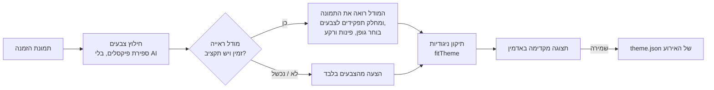

# עיצוב האירוע: ערכות מוכנות, התאמה אישית ויצירה מהזמנה

המסמך מסביר איך מערכת העיצוב של האירוע עובדת, ואיך העלאת הזמנה הופכת לעיצוב של עמודי האורחים.

## מה יש

**15 ערכות מוכנות** (`PRESETS` ב-`src/lib/platform/theme-rules.ts`), כל אחת עם צבעים, זוג גופנים, צורת פינות ורקע:

| ערכה | אווירה |
| --- | --- |
| זית (ברירת מחדל) | טבעי ונקי |
| זהב ושחור | יוקרתי וערבי |
| כחול מלכותי | רשמי, כמו הזמנה מודפסת |
| גן פורח | רענן ועדין |
| שקיעה | חם וצבעוני |
| ים | רענן ובהיר |
| תכלת ולבן | נקי ושמיימי |
| פסטל | מתוק ורך |
| ספורט | אנרגטי |
| זירה | כהה וחד, אולם ספורט |
| חצות | כחול כהה, אירוע לילה |
| ניאון | מסיבת נוער |
| רטרו | קרם ואדום, שנות ה-70 |
| שחור לבן | מינימלי, כמו מגזין |
| מסיבה | קונפטי וסגול |

**התאמה אישית** (דורשת `customTheme` ברישיון): תשעה צבעים, שישה זוגות גופנים, שלוש צורות פינות (רך, עגול מאוד, חד), חמישה רקעים (חלק, הילה, נקודות, פסים, קונפטי), כותרת ולוגו. מי שאין לו את זה ברישיון יכול לבחור ערכה מוכנה בלבד.

**כל ערכה עוברת בדיקה אוטומטית** (`theme-rules.test.ts`): טקסט ראשי 7:1 על הרקעים, טקסט משני וצבע ראשי 4.5:1. ערכה חדשה שלא עומדת בזה פשוט לא נכנסת.

## עיצוב מהזמנה

האדמין (עמוד העיצוב) מעלה תמונה של ההזמנה, או לוגו, באנר או דף מיתוג. מקבלים תצוגה מקדימה חיה. שום דבר לא נשמר עד שלוחצים על שמירה, והתמונה עצמה לא נשמרת בשרת.

1. **חילוץ צבעים** (`paletteFromPixels`): התמונה מוקטנת בשיטת השכן הקרוב, כדי שקו זהב דק על רקע כחול לא יהפוך לבוץ זית, והצבעים נספרים ומאוחדים לאשכולות. מקבלים עד שמונה צבעים עם האחוז של כל אחד.
2. **הצעה**: מודל הראייה (`THEME_FROM_IMAGE_SYSTEM` ב-`src/lib/prompts/theme.ts`) מקבל את התמונה, את הצבעים שנמדדו ואת האפשרויות, ומחזיר: תפקיד לכל צבע, גופנים, פינות, רקע, כותרת אם מודפסת בהזמנה, ומשפט הסבר. בלי מודל (אין מפתח, התקציב נגמר, שגיאה) ההצעה נבנית מהצבעים בלבד (`proposalFromPalette`), וזה גם מה שקורה בסביבת הדגמה.
3. **תיקון** (`fitTheme`): מה שהמודל מציע, התוצאה תמיד תקינה וקריאה. צבע שלא נקרא מוחלף, רקע ביניים נדחף לבהיר או לכהה, והטקסט מוכהה או מוסהר (באותו גוון) עד שהוא עומד ב-7:1, והטקסט המשני והצבע הראשי ב-4.5:1. בממשק מופיע אילו צבעים תוקנו. המודל יכול לטעות בטעם, לא בקריאות.

**עלות והגבלות:** קריאה אחת למודל ראייה, אותו סדר גודל כמו שאר שלבי ה-LLM, ונרשמת ביומן ההוצאות של האירוע (`theme_design`). אירוע שעבר את תקציב ה-AI ברישיון עדיין מקבל עיצוב, מהצבעים בלבד. עד 12 ניסיונות בשעה לאירוע.

**הרשאות:** נדרש `manage` באירוע ו-`customTheme` ברישיון. הנתיב הוא `POST /api/admin/e/<slug>/theme/from-invitation`, עובר דרך `eventAdminRoute`, ונרשם ביומן הביקורת (`theme.design`). השמירה עצמה היא הנתיב הרגיל, שבודק את הרישיון שוב.

## אבטחה

- צבע נכנס רק כ-`#rrggbb`, וצורה, רקע וגופן רק מרשימה סגורה. שום טקסט חופשי לא מגיע ל-CSS, גם לא מהמודל.
- ההצעה של המודל עוברת סכמה קפדנית ואז `fitTheme`. טקסט בתוך ההזמנה הוא תוכן שנקרא, לא הוראות (כתוב בפרומפט), והכותרת נחתכת ל-40 תווים ומנוקה מתווי בקרה.
- התמונה עוברת את אותה קליטת קבצים כמו שאר ההעלאות (סוג, גודל, קידוד מחדש), ונמחקת מהזיכרון בסוף הבקשה.

## שימוש חוזר: מחוץ לאפליקציה

- **סקריפט:** `npx tsx scripts/theme-from-image.ts invitation.png` מדפיס את הצבעים, ערכת עיצוב תקינה, מדדי ניגודיות ומשתני CSS. עם `--proposal proposal.json` הוא מתקן הצעה שמישהו כתב אחרי שהסתכל בתמונה (הסכמה: `ThemeProposalSchema`).
- **סקיל ל-Claude:** `.claude/skills/event-theme-from-invitation/SKILL.md`. כשמבקשים מ-Claude בפרויקט הזה "תתאים עיצוב להזמנה הזאת", הוא מסתכל בתמונה, כותב הצעה, מריץ את הסקריפט ומחזיר ערכת עיצוב, ואם צריך גם בונה עמוד שמתאים לסגנון.

## להוסיף ערכה חדשה

1. להוסיף רשומה ל-`PRESETS` (תשעה צבעים, גופנים, פינות, רקע, שורת הסבר).
2. `npm test`. אם הערכה לא עומדת בניגודיות, הבדיקה אומרת איזה צבע.
3. אין צורך בשום שינוי בממשק: הגלריה נבנית מהרשימה.

## מה לא נעשה

- קובצי הפוסטר עצמם (האמנות שה-AI מצייר) לא מקבלים את העיצוב. רק העמודים, האלבום והדפוס.
- לא נבדק מול מודל הראייה האמיתי, רק מול הספק המדומה והצבעים. כדאי לנסות עם כמה הזמנות אמיתיות ולראות שההצעה נאמנה.
- אין תמיכה בקובץ PDF של הזמנה, רק תמונה (אפשר לצלם מסך או לייצא כ-PNG).
